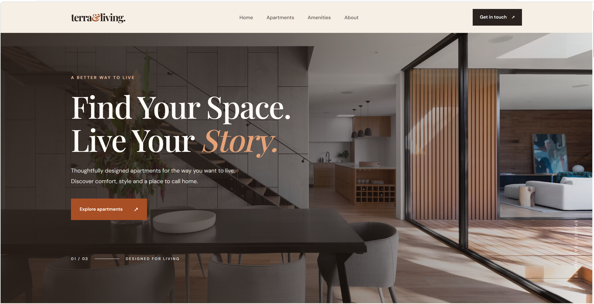
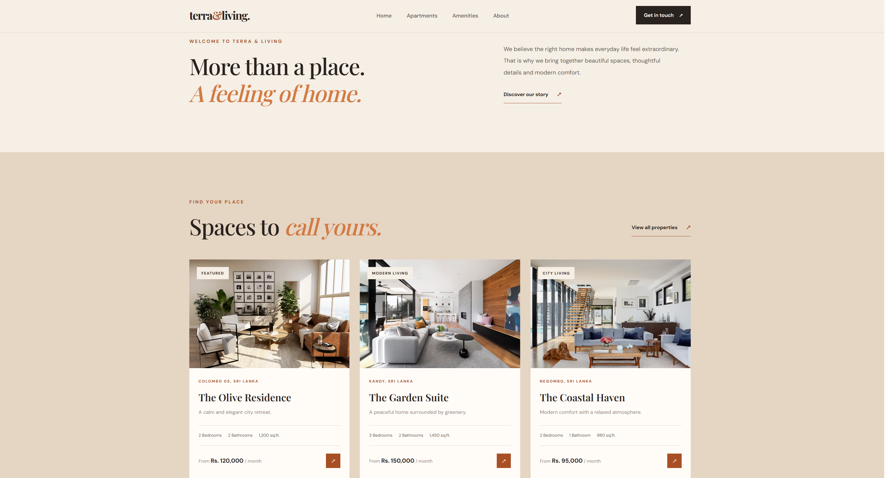
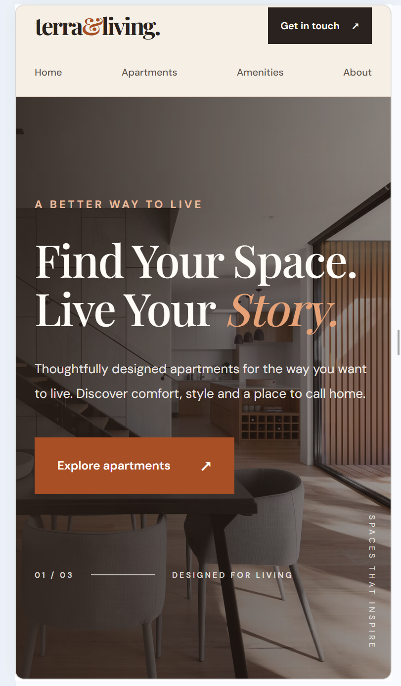

# TERRA & LIVING – Apartment Rental Landing Page

## Project Overview

TERRA & LIVING is a modern and responsive apartment rental landing page developed as part of the Oasis Infobyte Web Development and Designing Internship – Level 1, Task 1.

The website presents apartment rental options through a clean, elegant design with a warm brown and burnt-orange colour palette.

**Tagline:** Find a space. Feel at home.

## Technologies Used

- HTML5
- CSS3
- Google Fonts
- Flexbox
- CSS Grid
- Media Queries

## Features

- Responsive navigation bar
- Attractive hero section with a call-to-action button
- Introduction section
- Featured apartment cards
- Why Choose Us section
- Amenities section
- About section
- Contact section
- Footer with contact and social links
- Responsive layout for mobile and desktop screens
- Custom SVG brand logo

## Project Structure

```text
WebDev-L1-LandingPage/
│
├── index.html
├── style.css
├── README.md
│
└── screenshots/
    ├── desktop-home.png
    ├── apartments.png
    └── mobile-view.png
```

## How to Run the Project

1. Clone or download this repository.
2. Open the `WebDev-L1-LandingPage` folder in Visual Studio Code.
3. Open `index.html` using a browser or Live Server extension.

## Screenshots

### Desktop View



### Apartments Section


             (screenshots/apartments2.png)
             (screenshots/apartments3.png)
             (screenshots/apartments4.png)

### Mobile View



## Disclaimer

This project is a frontend demonstration. Apartment details, rental prices and contact information are sample content and do not represent actual rental listings.

## Internship Information

- **Organization:** Oasis Infobyte
- **Internship Track:** Web Development and Designing
- **Level:** Level 1
- **Task:** Task 01 – Landing Page